# 🏷️ DIAW Portfolio 👨‍💻

> [!NOTE]
> Website de portfólio profissional para apresentar trajetória, projetos, experiências e formas de contato de maneira **moderna, responsiva e acessível**.

<table>
  <tr>
    <td width="800px">
      <div align="justify">
        Este repositório contém o <b>portfólio profissional de Felipe de Castro Fonseca</b>, desenvolvido na disciplina <i>Desenvolvimento de Interações e Aplicações Web</i> da <b>PUC Minas</b>. O site reúne uma apresentação bilíngue (português e inglês), uma <i>linha do tempo de projetos</i> com tecnologias, repositórios e demonstrações, um espaço para <i>experiências profissionais e acadêmicas</i> e uma página de <i>contato</i> com links diretos e formulário de envio por e-mail. A aplicação é construída com <b>Spring Boot</b> e <b>Thymeleaf</b> e será hospedada gratuitamente em nuvem.
      </div>
    </td>
    <td>
      <div>
        
      </div>
    </td>
  </tr>
</table>

---

## 🚧 Status do Projeto

    

| Sprint | Entrega | Status |
| :--- | :--- | :---: |
| **Lab01S01** | Planejamento, wireframes, protótipo inicial, navegação e layout principal | ✅ |
| **Lab01S02** | Sobre Mim bilíngue, timeline dinâmica, experiências organizadas, formulário com envio de e-mail e validações | ✅ |
| **Lab01S03** | Hospedagem em nuvem e apresentação final | ⏳ |

---

## 📚 Índice
- [Sobre o Projeto](#-sobre-o-projeto)
- [Funcionalidades Principais](#-funcionalidades-principais)
- [Tecnologias Utilizadas](#-tecnologias-utilizadas)
- [Arquitetura](#-arquitetura)
- [Instalação e Execução](#-instalação-e-execução)
  - [Variáveis de Ambiente](#-variáveis-de-ambiente)
- [Estrutura de Pastas](#-estrutura-de-pastas)
- [Demonstração](#-demonstração)
- [Testes](#-testes)
- [Autores](#-autores)

---

## 📝 Sobre o Projeto

O projeto surgiu como laboratório da disciplina **DIAW (PUC Minas)**, cujo objetivo é projetar, desenvolver e hospedar em nuvem um website de portfólio profissional pessoal.

O site resolve um problema comum de quem está entrando no mercado: reunir, em um único lugar, **quem eu sou, o que já construí e como me encontrar**. Em vez de informações espalhadas entre currículo, GitHub e LinkedIn, recrutadores e colegas encontram uma apresentação objetiva, projetos com demonstrações visuais e canais de contato diretos.

---

## ✨ Funcionalidades Principais

- 👤 **Sobre Mim:** Apresentação em português e inglês (internacionalização do Spring, troca por `?lang=pt|en` e idioma lembrado em cookie), com foto, formação, área de atuação, interesses, objetivo, idiomas, disponibilidade e habilidades e competências agrupadas por categoria.
- 🗂️ **Projetos:** Linha do tempo gerada a partir de um arquivo JSON, do mais antigo ao mais recente, com nome, disciplina, descrição, tecnologias, link do repositório e imagem ampliável de cada projeto. Filtro por tecnologia e animação de entrada ao rolar a página.
- 💼 **Experiências:** Agrupadas por tipo (formação, projeto acadêmico, curso, profissional, estágio, freela, open source, evento) e ordenadas da mais recente para a mais antiga, com instituição, cargo, período e competências.
- 📨 **Contato:** Ícones clicáveis (E-mail, WhatsApp, LinkedIn, GitHub, Instagram) e formulário que envia a mensagem por e-mail via API do [Resend](https://resend.com/).
- ✅ **Validações:** No navegador (mensagens por campo, contador de caracteres) e no servidor com Bean Validation; proteção anti-spam com *honeypot* e padrão Post/Redirect/Get.
- 📱 **Design Responsivo:** Layout adaptado para desktop e mobile, com menu de navegação recolhível.
- 🌗 **Tema Claro/Escuro:** Segue a preferência do sistema, com alternância manual.

---

## 🛠 Tecnologias Utilizadas

### 💻 Front-end

* **Template Engine:** Thymeleaf 3.1 (fragmentos de layout reutilizáveis)
* **Linguagens:** HTML5, CSS3, JavaScript (ES6+)
* **Ícones e Fontes:** [Bootstrap Icons](https://icons.getbootstrap.com/) 1.11 e Google Fonts (Inter, Space Grotesk)

### 🖥️ Back-end

* **Linguagem/Runtime:** Java 25
* **Framework:** Spring Boot 4.1.1 (Spring Web MVC, i18n com `MessageSource`)
* **Validação:** Jakarta Bean Validation (`spring-boot-starter-validation`)
* **Dados do portfólio:** arquivos JSON lidos com Jackson 3
* **E-mail:** API HTTP do [Resend](https://resend.com/) chamada com `RestClient`
* **Testes:** JUnit 5, MockMvc, Mockito e AssertJ
* **Build Tool:** Maven (via Maven Wrapper)

### 📦 Dependências

| Dependência | Uso |
| :--- | :--- |
| `spring-boot-starter-webmvc` | Servidor web, controllers, `RestClient` e Jackson |
| `spring-boot-starter-thymeleaf` | Renderização das páginas |
| `spring-boot-starter-validation` | Validação do formulário de contato |
| `spring-boot-devtools` | Reinício automático em desenvolvimento |
| `spring-boot-starter-webmvc-test` / `spring-boot-starter-thymeleaf-test` | Testes com MockMvc |

### ⚙️ Infraestrutura & DevOps

* **Prototipação:** Figma
* **E-mail transacional:** Resend (plano gratuito)
* **Cloud (previsto):** Render — o envio por API HTTP evita o bloqueio de portas SMTP no plano gratuito

---

## 🏗 Arquitetura

A aplicação segue o padrão **MVC** do Spring, renderizando as páginas no servidor:

- **Controllers**
  - `PageController` — rotas `/`, `/projetos` e `/experiencias`.
  - `ContatoController` — `GET/POST /contato`: valida o formulário, envia o e-mail e redireciona (Post/Redirect/Get) com mensagem de sucesso ou erro.
- **Services**
  - `PortfolioService` — lê `data/projetos.json` e `data/experiencias.json`, ordena os projetos cronologicamente, lista as tecnologias do filtro e agrupa as experiências por tipo.
  - `EmailService` — envia a mensagem pela API do Resend; o e-mail chega com *Reply-To* do visitante, para responder direto.
- **Model** — records `Projeto` e `Experiencia`, enum `TipoExperiencia` e o formulário `ContatoForm` com as regras de validação.
- **Config** (`WebConfig`) — `CookieLocaleResolver` + `LocaleChangeInterceptor` para o idioma da página Sobre Mim (`messages.properties` e `messages_en.properties`).
- **View** — templates Thymeleaf; `fragments/layout.html` define `head`, cabeçalho com menu e rodapé, reaproveitados por todas as páginas. O JavaScript apenas melhora a experiência (filtro, animações, validação imediata); tudo funciona sem ele.

A renderização no servidor dispensa um build de front-end separado e mantém o projeto em um único artefato, simples de hospedar. O conteúdo fica separado do código: para adicionar um projeto ou experiência basta editar o JSON correspondente em `src/main/resources/data/` (e colocar a imagem em `static/img/projetos/`).

---

## 🔧 Instalação e Execução

### Pré-requisitos

* **Java JDK:** Versão **25** ou superior
* **Git**

> O Maven não precisa estar instalado: o projeto usa o Maven Wrapper (`mvnw`).

### 📦 Instalação

```bash
git clone https://github.com/FelipeFonseca2/DIAW-Portfolio.git
cd DIAW-Portfolio
```

### 🔑 Variáveis de Ambiente

O formulário de contato envia e-mails pelo [Resend](https://resend.com/). Crie uma conta gratuita, gere uma API key em **API Keys** e crie um arquivo **`.env`** na raiz do projeto (veja `.env.example`; o `.env` não é versionado):

```
RESEND_API_KEY=re_sua_api_key_aqui
```

| Variável | Descrição | Padrão |
| :--- | :--- | :--- |
| `RESEND_API_KEY` | Chave da API do Resend (obrigatória para enviar e-mails). | — |
| `CONTATO_DESTINATARIO` | E-mail que recebe as mensagens. | `felipefonseca2006@gmail.com` |
| `CONTATO_REMETENTE` | Remetente exibido no e-mail. | `Portfólio <onboarding@resend.dev>` |

> [!NOTE]
> Com o remetente de teste `onboarding@resend.dev`, o Resend só entrega para o e-mail da própria conta, então o destinatário deve ser o e-mail cadastrado no Resend. Sem a chave, o site funciona normalmente e o formulário exibe uma mensagem de erro amigável.

### ⚡ Como Executar a Aplicação

```bash
# Linux/macOS
./mvnw spring-boot:run

# Windows
mvnw.cmd spring-boot:run
```

🚀 *A aplicação estará disponível em **http://localhost:8080**.*

---

## 📂 Estrutura de Pastas

```
.
├── docs/
│   ├── prototipo/                  # 🖼️ Capturas do protótipo (Sprint 01)
│   ├── screenshots/                # 🖼️ Capturas da versão funcional
│   └── wireframes/                 # 📐 Wireframes exportados do Figma
├── src/
│   ├── main/
│   │   ├── java/com/example/DIAW_Portfolio/
│   │   │   ├── config/             # 🔧 Internacionalização (idioma por parâmetro/cookie)
│   │   │   ├── controller/         # 🎮 Páginas e formulário de contato
│   │   │   ├── model/              # 🧬 Projeto, Experiência, tipos e ContatoForm
│   │   │   ├── service/            # ⚙️ Leitura dos dados e envio de e-mail
│   │   │   └── DiawPortfolioApplication.java
│   │   └── resources/
│   │       ├── data/               # 🗄️ projetos.json e experiencias.json
│   │       ├── static/
│   │       │   ├── css/            # 🎨 Estilos globais e tema claro/escuro
│   │       │   ├── js/             # 🛠️ Menu, tema, filtro, animações e validação
│   │       │   └── img/            # 🖼️ Logo, foto e imagens dos projetos
│   │       ├── templates/
│   │       │   ├── fragments/      # 🧱 Layout: head, cabeçalho e rodapé
│   │       │   └── *.html          # 📄 Páginas: sobre, projetos, experiencias, contato
│   │       ├── messages*.properties # 🌎 Textos da página Sobre Mim (PT/EN)
│   │       └── application.properties
│   └── test/                       # 🧪 Testes de controllers e serviços
├── .env.example                    # 🧩 Exemplo das variáveis de ambiente
├── mvnw / mvnw.cmd                 # 📦 Maven Wrapper
└── pom.xml                         # 🛠️ Build e dependências
```

---

## 🎥 Demonstração

### 📐 Wireframes (Figma)

🔗 [Acesse o protótipo no Figma](<link-do-figma>)

| Sobre Mim | Projetos |
| :---: | :---: |
|  |  |
| **Experiências** | **Contato** |
|  |  |

### 🌐 Aplicação Web

| Sobre Mim (PT) | About Me (EN) |
| :---: | :---: |
| 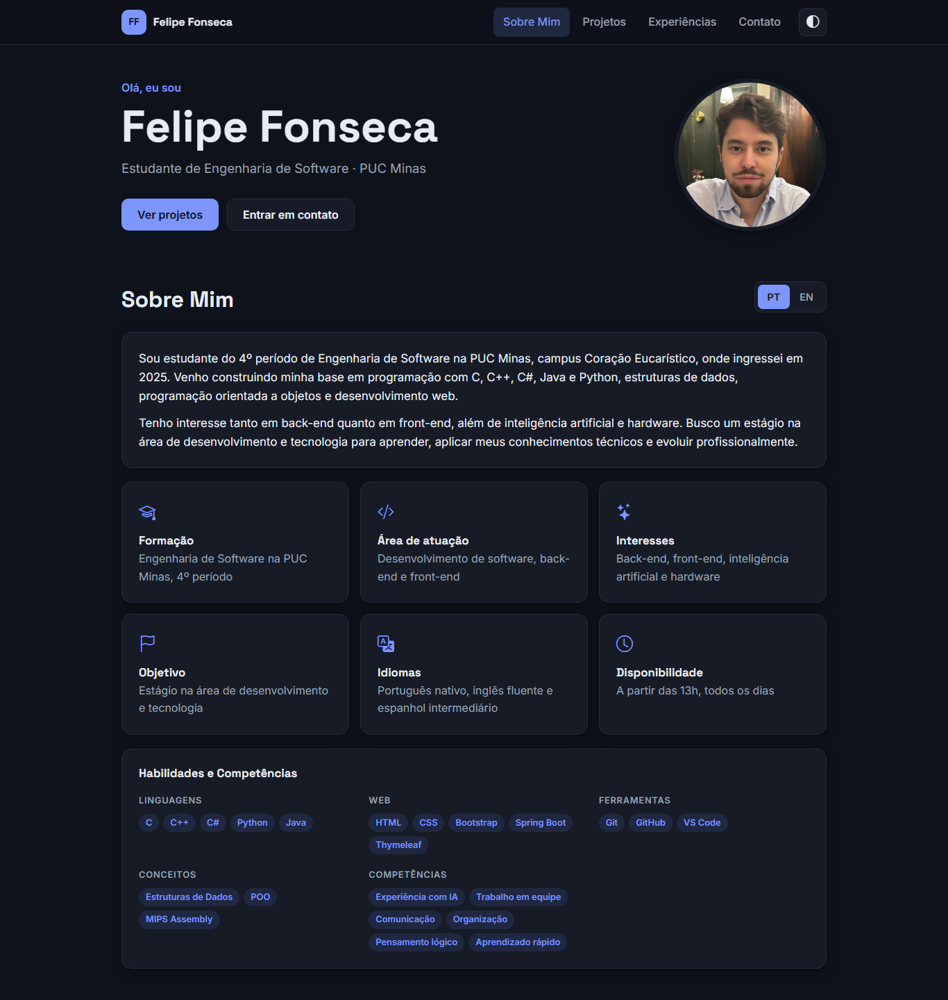 | 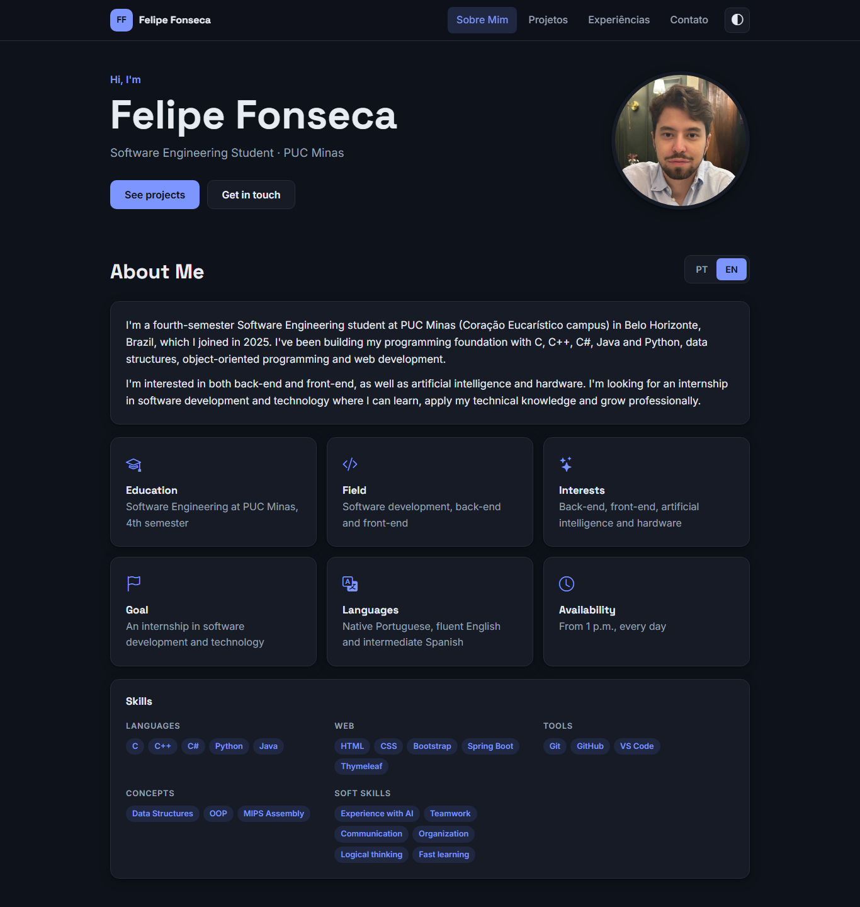 |
| **Projetos (timeline com filtro)** | **Experiências** |
| 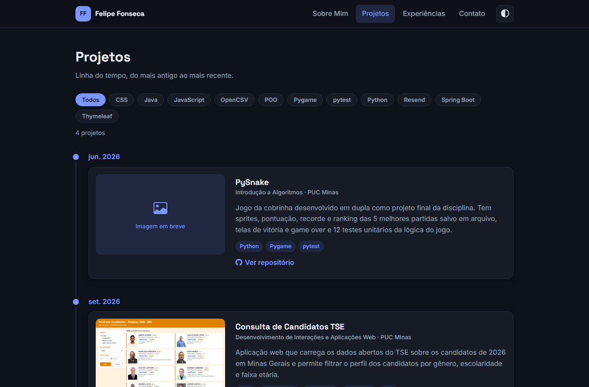 | 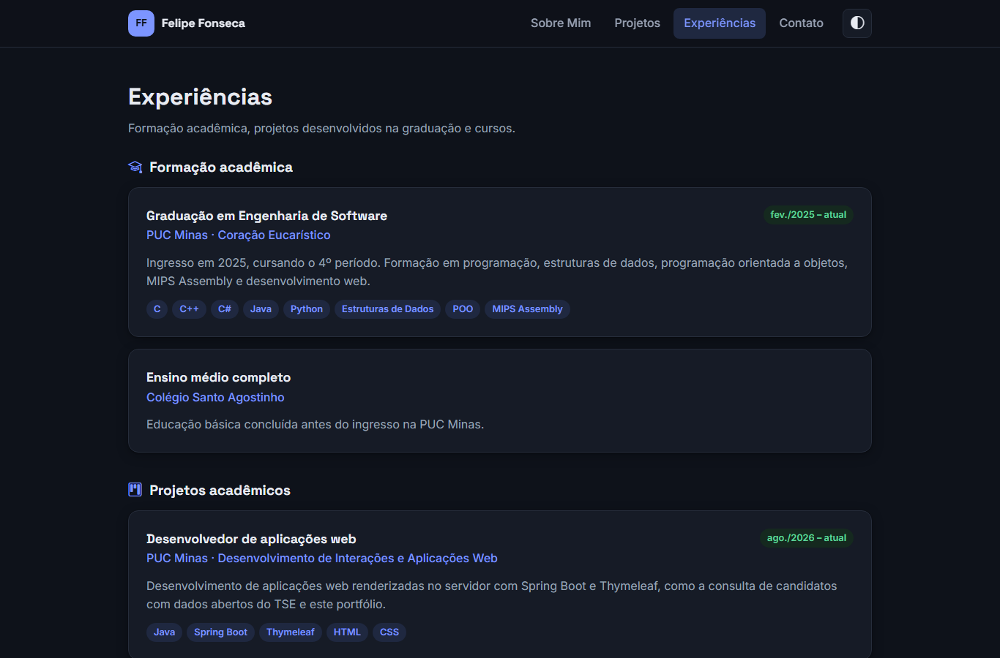 |
| **Contato** | **Validação do formulário** |
| 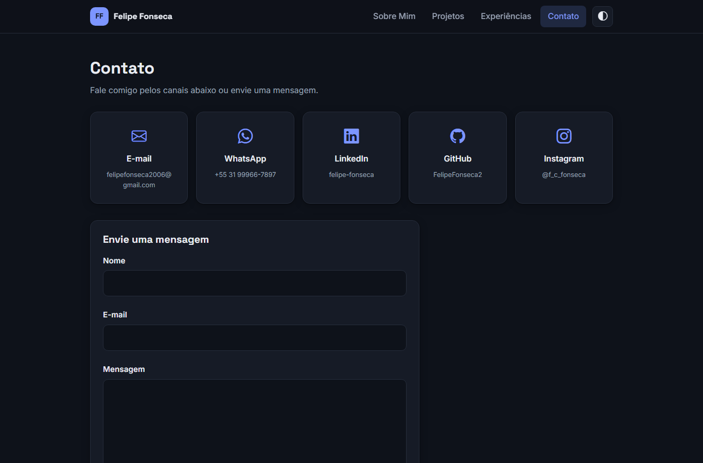 | 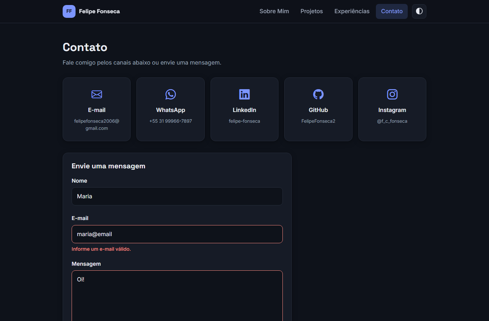 |

**Versão mobile**

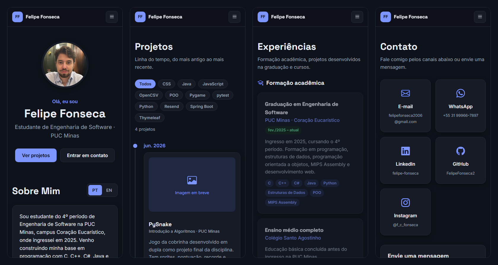

<details>
<summary><b>Protótipo inicial (Sprint 01)</b></summary>

| Sobre Mim | Projetos |
| :---: | :---: |
| 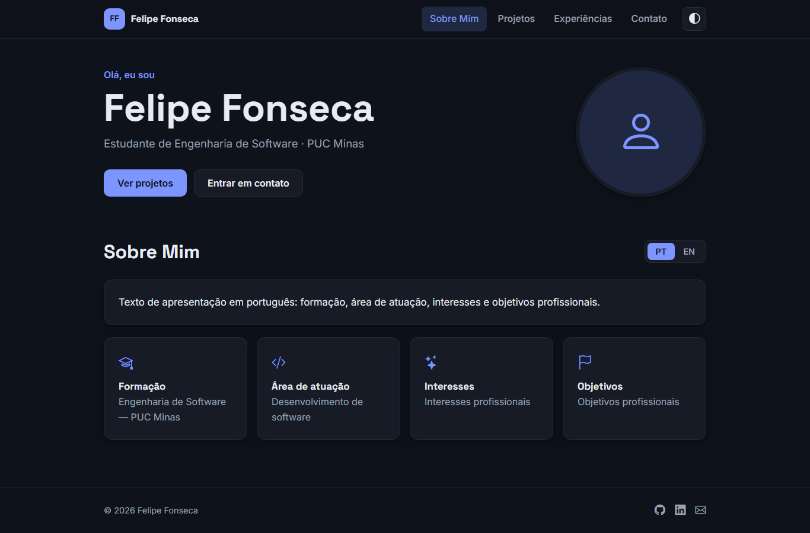 | 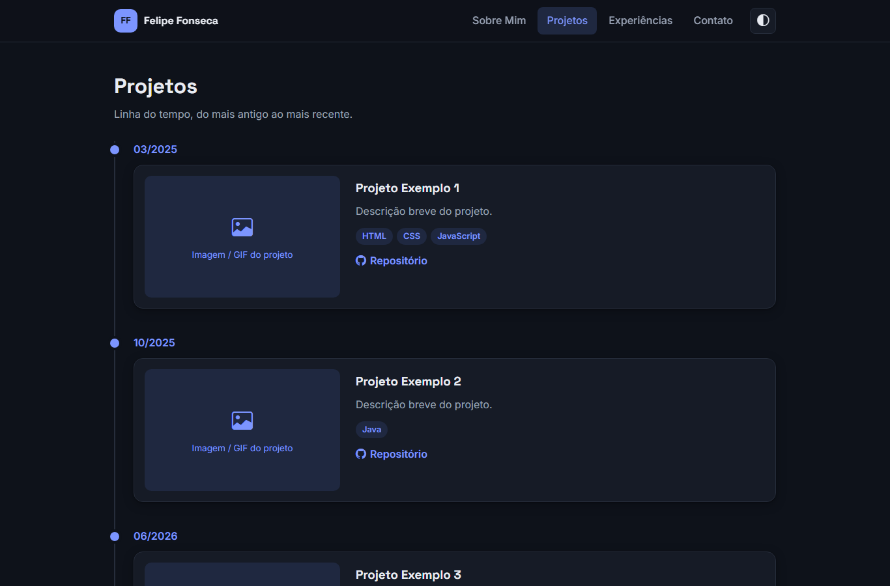 |
| **Experiências** | **Contato** |
| 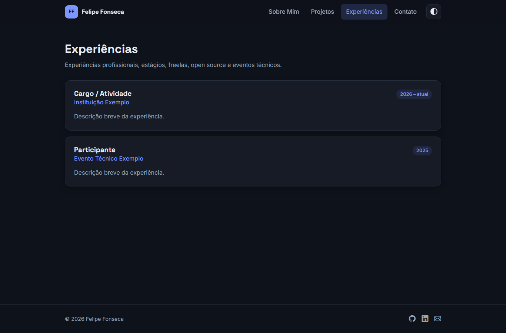 | 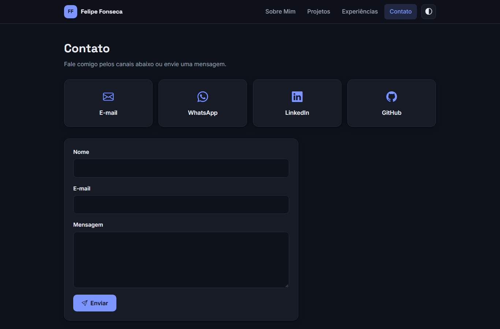 |

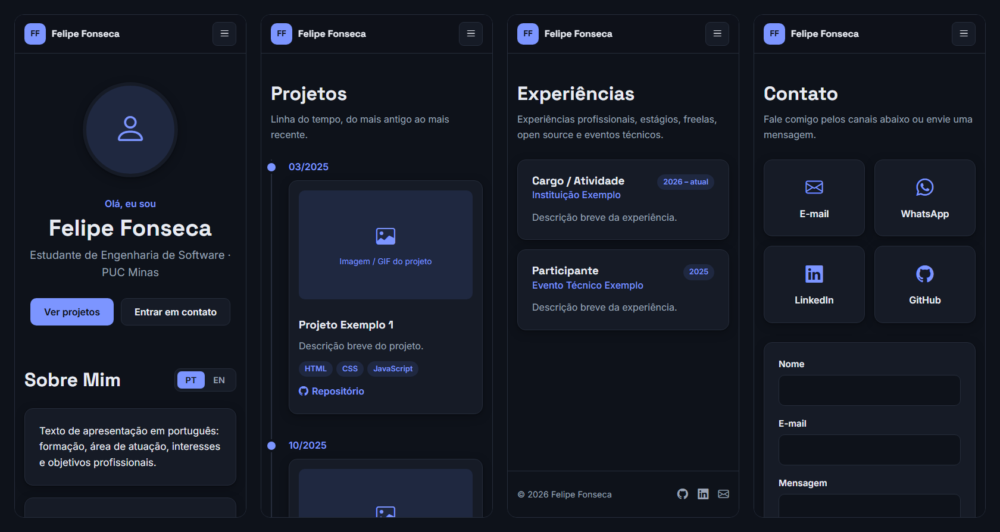

</details>

---

## 🧪 Testes

Testes com **JUnit 5**, **MockMvc** e **Mockito** (o envio de e-mail é simulado, nenhuma mensagem real é enviada):

- `PageControllerTests` — renderização das páginas, troca de idioma por parâmetro e cookie, timeline e filtros.
- `ContatoControllerTests` — envio válido, erros de validação, honeypot e falha no envio de e-mail.
- `PortfolioServiceTests` — ordem cronológica dos projetos e agrupamento das experiências.

```bash
./mvnw test
```

---

## 👥 Autores

| 👤 Nome | 🖼️ Foto | :octocat: GitHub | 💼 LinkedIn | 📤 Gmail |
|---------|----------|-----------------|-------------|-----------|
| Felipe Fonseca | <div align="center"></div> | <div align="center"><a href="https://github.com/FelipeFonseca2"></a></div> | <div align="center"><a href="https://www.linkedin.com/in/felipe-fonseca-31924b374"></a></div> | <div align="center"><a href="mailto:felipefonseca2006@gmail.com"></a></div> |
