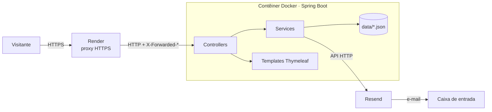
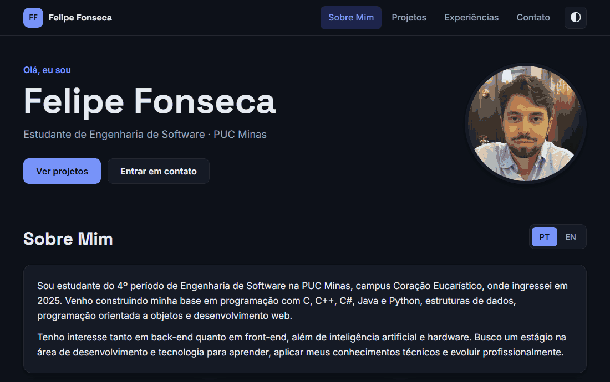
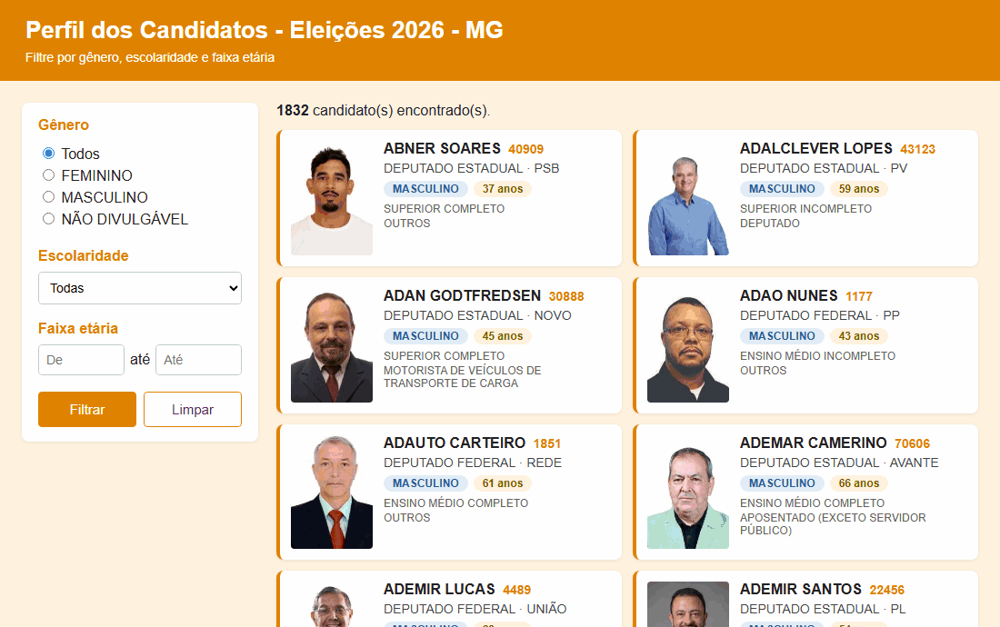
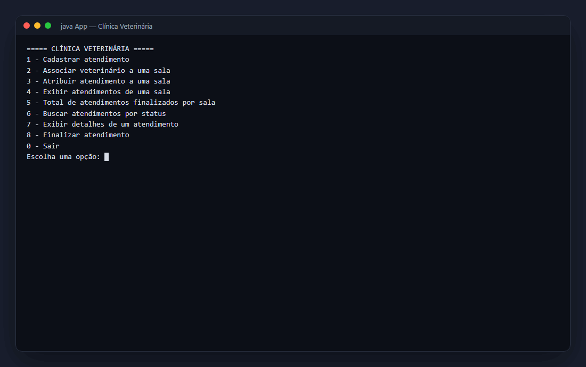

# 🏷️ DIAW Portfolio 👨‍💻

> [!NOTE]
> Website de portfólio profissional para apresentar trajetória, projetos, experiências e formas de contato de maneira **moderna, responsiva e acessível**.

<table>
  <tr>
    <td width="800px">
      <div align="justify">
        Este repositório contém o <b>portfólio profissional de Felipe de Castro Fonseca</b>, desenvolvido na disciplina <i>Desenvolvimento de Interações e Aplicações Web</i> da <b>PUC Minas</b>. O site reúne uma apresentação bilíngue (português e inglês), uma <i>linha do tempo de projetos</i> com tecnologias, repositórios e GIFs dos projetos em execução, as <i>experiências acadêmicas e cursos</i> e uma página de <i>contato</i> com links diretos e formulário de envio por e-mail. A aplicação é construída com <b>Spring Boot</b> e <b>Thymeleaf</b> e está hospedada gratuitamente no <b>Render</b> em um contêiner Docker.
      </div>
    </td>
    <td>
      <div>
        
      </div>
    </td>
  </tr>
</table>

---

## 🚧 Status do Projeto

      

| Sprint | Entrega | Status |
| :--- | :--- | :---: |
| **Lab01S01** | Planejamento, wireframes, protótipo inicial, navegação e layout principal | ✅ |
| **Lab01S02** | Sobre Mim bilíngue, timeline dinâmica, experiências organizadas, formulário com envio de e-mail e validações | ✅ |
| **Lab01S03** | Deploy no Render, ajustes visuais e de usabilidade, GIFs dos projetos em execução e README final | ✅ |

---

## 🔗 Links Úteis

* 🌐 **Site publicado:** [diaw-portfolio.onrender.com](https://diaw-portfolio.onrender.com)
  > 💤 O plano gratuito do Render suspende o serviço após 15 minutos sem acessos; o primeiro acesso depois disso pode levar cerca de 1 minuto.
* 📂 **Repositório:** [github.com/FelipeFonseca2/DIAW-Portfolio](https://github.com/FelipeFonseca2/DIAW-Portfolio)

---

## 📚 Índice
- [Sobre o Projeto](#-sobre-o-projeto)
- [Funcionalidades Principais](#-funcionalidades-principais)
- [Como Usar o Site](#-como-usar-o-site)
- [Tecnologias Utilizadas](#-tecnologias-utilizadas)
- [Arquitetura](#-arquitetura)
- [Instalação e Execução](#-instalação-e-execução)
  - [Variáveis de Ambiente](#-variáveis-de-ambiente)
  - [Como Editar o Conteúdo](#-como-editar-o-conteúdo)
- [Deploy](#-deploy)
- [Estrutura de Pastas](#-estrutura-de-pastas)
- [Demonstração](#-demonstração)
- [Testes](#-testes)
- [Autores](#-autores)

---

## 📝 Sobre o Projeto

O projeto surgiu como laboratório da disciplina **DIAW (PUC Minas)**, cujo objetivo é projetar, desenvolver e hospedar em nuvem um website de portfólio profissional pessoal.

O site resolve um problema comum de quem está entrando no mercado: reunir, em um único lugar, **quem eu sou, o que já construí e como me encontrar**. Em vez de informações espalhadas entre currículo, GitHub e LinkedIn, recrutadores e colegas encontram uma apresentação objetiva, projetos com demonstrações visuais e canais de contato diretos.

---

## ✨ Funcionalidades Principais

- 👤 **Sobre Mim:** Apresentação em português e inglês (internacionalização do Spring, troca por `?lang=pt|en` e idioma lembrado em cookie), com foto, formação, área de atuação, interesses, objetivo, idiomas, disponibilidade e habilidades e competências agrupadas por categoria.
- 🗂️ **Projetos:** Linha do tempo gerada a partir de um arquivo JSON, do mais antigo ao mais recente, com nome, disciplina, descrição, tecnologias, links do repositório e do site e GIF ampliável do projeto em execução. Filtro por tecnologia (compartilhável pela URL, ex.: `/projetos?tecnologia=Java`) e animação de entrada ao rolar a página.
- 💼 **Experiências:** Agrupadas por tipo (formação, projeto acadêmico, curso, profissional, estágio, freela, open source, evento) e ordenadas da mais recente para a mais antiga, com instituição, cargo, período e competências.
- 📨 **Contato:** Ícones clicáveis (E-mail, WhatsApp, LinkedIn, GitHub, Instagram) e formulário que envia a mensagem por e-mail via API do [Resend](https://resend.com/).
- ✅ **Validações:** No navegador (mensagens por campo, contador de caracteres) e no servidor com Bean Validation; proteção anti-spam com *honeypot* e padrão Post/Redirect/Get.
- 📱 **Design Responsivo:** Layout adaptado para desktop e mobile, com menu recolhível (fecha com <kbd>Esc</kbd> ou clicando fora).
- 🌗 **Tema Claro/Escuro:** Segue a preferência do sistema, com alternância manual.
- ♿ **Acessibilidade:** Link "Pular para o conteúdo", navegação por teclado, `aria-*` nos componentes interativos e respeito a `prefers-reduced-motion`.
- 🔎 **SEO e compartilhamento:** Descrição por página, URL canônica e tags Open Graph com imagem de prévia para WhatsApp e LinkedIn.
- 🚫 **Página de erro própria:** 404 e erros inesperados exibidos com o layout do site.

---

## 🧭 Como Usar o Site

| Página | O que fazer |
| :--- | :--- |
| **Sobre Mim** (`/`) | Use os botões **PT / EN** para trocar o idioma da apresentação; a escolha fica salva. |
| **Projetos** (`/projetos`) | Clique em uma tecnologia para filtrar a linha do tempo e no GIF para ampliá-lo. **Ver repositório** abre o código no GitHub. |
| **Experiências** (`/experiencias`) | Consulte formação, projetos acadêmicos e cursos, agrupados por tipo. |
| **Contato** (`/contato`) | Clique em um ícone para abrir o canal (e-mail, WhatsApp etc.) ou preencha nome, e-mail e mensagem e clique em **Enviar mensagem**. |

O ícone ◐ no canto superior direito alterna entre tema claro e escuro.

---

## 🛠 Tecnologias Utilizadas

### 💻 Front-end

* **Template Engine:** Thymeleaf 3.1 (fragmentos de layout reutilizáveis)
* **Linguagens:** HTML5, CSS3, JavaScript (ES6+), sem frameworks
* **Ícones e Fontes:** [Bootstrap Icons](https://icons.getbootstrap.com/) 1.11 e Google Fonts (Inter, Space Grotesk)

### 🖥️ Back-end

* **Linguagem/Runtime:** Java 25
* **Framework:** Spring Boot 4.1.1 (Spring Web MVC, i18n com `MessageSource`)
* **Validação:** Jakarta Bean Validation (`spring-boot-starter-validation`)
* **Dados do portfólio:** arquivos JSON lidos com Jackson 3
* **E-mail:** API HTTP do [Resend](https://resend.com/) chamada com `RestClient`
* **Testes:** JUnit 5, MockMvc, Mockito e AssertJ
* **Build Tool:** Maven (via Maven Wrapper)

### 📦 Dependências

| Dependência | Uso |
| :--- | :--- |
| `spring-boot-starter-webmvc` | Servidor web, controllers, `RestClient` e Jackson |
| `spring-boot-starter-thymeleaf` | Renderização das páginas |
| `spring-boot-starter-validation` | Validação do formulário de contato |
| `spring-boot-devtools` | Reinício automático em desenvolvimento (não vai para o JAR de produção) |
| `spring-boot-starter-webmvc-test` / `spring-boot-starter-thymeleaf-test` | Testes com MockMvc e testes de integração |

### ⚙️ Infraestrutura & DevOps

* **Contêiner:** Docker (build multi-stage com imagens `eclipse-temurin:25`)
* **Cloud:** [Render](https://render.com/) (Web Service gratuito, configurado por Blueprint em `render.yaml`, deploy automático a cada push na `main`)
* **E-mail transacional:** Resend (plano gratuito) — o envio por API HTTP evita o bloqueio de portas SMTP no plano gratuito do Render

---

## 🏗 Arquitetura

A aplicação segue o padrão **MVC** do Spring, renderizando as páginas no servidor:



- **Controllers**
  - `PageController` — rotas `/`, `/projetos` e `/experiencias`.
  - `ContatoController` — `GET/POST /contato`: valida o formulário, envia o e-mail e redireciona (Post/Redirect/Get) para `/contato#formulario` com mensagem de sucesso ou erro.
  - `LayoutAdvice` — disponibiliza a todas as páginas as URLs absolutas usadas nas tags Open Graph e na URL canônica.
- **Services**
  - `PortfolioService` — lê `data/projetos.json` e `data/experiencias.json`, ordena os projetos cronologicamente, lista as tecnologias do filtro e agrupa as experiências por tipo.
  - `EmailService` — envia a mensagem pela API do Resend; o e-mail chega com *Reply-To* do visitante, para responder direto.
- **Model** — records `Projeto` e `Experiencia`, enum `TipoExperiencia` e o formulário `ContatoForm` com as regras de validação.
- **Config** (`WebConfig`) — `CookieLocaleResolver` + `LocaleChangeInterceptor` para o idioma da página Sobre Mim (`messages.properties` e `messages_en.properties`).
- **View** — templates Thymeleaf; `fragments/layout.html` define `head`, cabeçalho com menu e rodapé, reaproveitados por todas as páginas, e `error.html` é a página de erro. O JavaScript apenas melhora a experiência (filtro, animações, validação imediata); tudo funciona sem ele.

**Decisões para produção** (`application.properties`): porta lida da variável `PORT`, `forward-headers-strategy` para gerar URLs `https` atrás do proxy do Render, compressão gzip, arquivos estáticos versionados pelo conteúdo (ex.: `style-8927….css`) com cache de 1 ano e nenhum *stack trace* nas respostas de erro.

A renderização no servidor dispensa um build de front-end separado e mantém o projeto em um único artefato, simples de hospedar.

---

## 🔧 Instalação e Execução

### Pré-requisitos

* **Java JDK:** Versão **25** ou superior
* **Git**
* **Docker** (opcional, apenas para testar a imagem de produção)

> O Maven não precisa estar instalado: o projeto usa o Maven Wrapper (`mvnw`).

### 📦 Instalação

```bash
git clone https://github.com/FelipeFonseca2/DIAW-Portfolio.git
cd DIAW-Portfolio
```

### 🔑 Variáveis de Ambiente

O formulário de contato envia e-mails pelo [Resend](https://resend.com/). Crie uma conta gratuita, gere uma API key em **API Keys** e crie um arquivo **`.env`** na raiz do projeto (veja `.env.example`; o `.env` não é versionado):

```
RESEND_API_KEY=re_sua_api_key_aqui
```

| Variável | Descrição | Padrão |
| :--- | :--- | :--- |
| `RESEND_API_KEY` | Chave da API do Resend (obrigatória para enviar e-mails). | — |
| `CONTATO_DESTINATARIO` | E-mail que recebe as mensagens. | `felipefonseca2006@gmail.com` |
| `CONTATO_REMETENTE` | Remetente exibido no e-mail. | `Portfólio <onboarding@resend.dev>` |
| `PORT` | Porta HTTP (definida automaticamente pelo Render). | `8080` |

> [!NOTE]
> Com o remetente de teste `onboarding@resend.dev`, o Resend só entrega para o e-mail da própria conta, então o destinatário deve ser o e-mail cadastrado no Resend. Sem a chave, o site funciona normalmente e o formulário exibe uma mensagem de erro amigável.

### ⚡ Como Executar a Aplicação

```bash
# Linux/macOS
./mvnw spring-boot:run

# Windows
mvnw.cmd spring-boot:run
```

🚀 *A aplicação estará disponível em **http://localhost:8080**.* Com o DevTools, alterações em templates, CSS e JS são recarregadas automaticamente.

Para rodar como em produção (JAR ou Docker):

```bash
# JAR
./mvnw package
java -jar target/DIAW-Portfolio-0.0.1-SNAPSHOT.jar

# Docker
docker build -t diaw-portfolio .
docker run -p 8080:8080 --env-file .env diaw-portfolio
```

### 🧾 Como Editar o Conteúdo

O conteúdo fica separado do código, sem necessidade de alterar Java:

| Conteúdo | Onde editar |
| :--- | :--- |
| Projetos da timeline | `src/main/resources/data/projetos.json` (imagem/GIF em `static/img/projetos/`) |
| Experiências, formação e cursos | `src/main/resources/data/experiencias.json` (`tipo`: `FORMACAO`, `PROJETO_ACADEMICO`, `CURSO`, `PROFISSIONAL`, `ESTAGIO`, `FREELA`, `OPEN_SOURCE`, `EVENTO`) |
| Textos da página Sobre Mim | `src/main/resources/messages.properties` (PT) e `messages_en.properties` (EN) |
| Foto e imagem de prévia | `static/img/felipe.webp` e `static/img/og-image.jpg` |

Exemplo de projeto em `projetos.json` (`siteUrl` e `imagemUrl` são opcionais):

```json
{
  "nome": "Meu Projeto",
  "contexto": "Disciplina · PUC Minas",
  "descricao": "O que o projeto faz.",
  "tecnologias": ["Java", "Spring Boot"],
  "repositorioUrl": "https://github.com/FelipeFonseca2/meu-projeto",
  "siteUrl": null,
  "imagemUrl": "/img/projetos/meu-projeto.gif",
  "data": "2026-11"
}
```

Os testes verificam que os JSONs são válidos e que toda imagem referenciada existe.

---

## 🚀 Deploy

O site é publicado no **Render** como Web Service Docker, a partir do `Dockerfile` e do Blueprint `render.yaml`:

1. **Build multi-stage:** a primeira etapa compila e empacota o JAR com o Maven Wrapper (`eclipse-temurin:25-jdk`); a segunda roda apenas o JAR em `eclipse-temurin:25-jre`, com usuário sem privilégios e memória da JVM ajustada ao limite de 512 MB do plano gratuito.
2. **Criar o serviço:** no painel do Render, **New → Blueprint**, selecione este repositório e confirme. O Render lê o `render.yaml` (serviço `diaw-portfolio`, plano gratuito, região Virginia, health check em `/`).
3. **Configurar o segredo:** informe `RESEND_API_KEY` quando o Render solicitar (ou em **Environment**). A chave não fica no repositório.
4. **Deploy contínuo:** cada push na branch `main` gera um novo deploy automaticamente.

---

## 📂 Estrutura de Pastas

```
.
├── docs/
│   ├── prototipo/                  # 🖼️ Capturas do protótipo (Sprint 01)
│   ├── screenshots/                # 🖼️ Capturas da versão final
├── src/
│   ├── main/
│   │   ├── java/com/example/DIAW_Portfolio/
│   │   │   ├── config/             # 🔧 Internacionalização (idioma por parâmetro/cookie)
│   │   │   ├── controller/         # 🎮 Páginas, contato e dados comuns do layout
│   │   │   ├── model/              # 🧬 Projeto, Experiência, tipos e ContatoForm
│   │   │   ├── service/            # ⚙️ Leitura dos dados e envio de e-mail
│   │   │   └── DiawPortfolioApplication.java
│   │   └── resources/
│   │       ├── data/               # 🗄️ projetos.json e experiencias.json
│   │       ├── static/
│   │       │   ├── css/            # 🎨 Estilos globais e tema claro/escuro
│   │       │   ├── js/             # 🛠️ Menu, tema, filtro, animações e validação
│   │       │   └── img/            # 🖼️ Logo, foto, prévia e GIFs dos projetos
│   │       ├── templates/
│   │       │   ├── fragments/      # 🧱 Layout: head, cabeçalho e rodapé
│   │       │   ├── error.html      # 🚫 Página de erro (404 e demais)
│   │       │   └── *.html          # 📄 Páginas: sobre, projetos, experiencias, contato
│   │       ├── messages*.properties # 🌎 Textos da página Sobre Mim (PT/EN)
│   │       └── application.properties
│   └── test/                       # 🧪 Testes unitários, de controllers e de integração
├── .env.example                    # 🧩 Exemplo das variáveis de ambiente
├── .dockerignore                   # 🐳 Arquivos fora da imagem Docker
├── Dockerfile                      # 🐳 Build multi-stage da imagem de produção
├── render.yaml                     # ☁️ Blueprint do Render
├── mvnw / mvnw.cmd                 # 📦 Maven Wrapper
└── pom.xml                         # 🛠️ Build e dependências
```

---

## 🎥 Demonstração

<div align="center">
  
  <p><i>Sobre Mim em PT/EN, timeline com filtro, experiências e contato.</i></p>
</div>

### 🌐 Aplicação Web

| Sobre Mim (PT) | About Me (EN) |
| :---: | :---: |
|  |  |
| **Projetos (timeline com filtro)** | **Experiências** |
|  |  |
| **Contato** | **Validação do formulário** |
|  |  |

**Versão mobile**


### 🗂️ Projetos em Execução

GIFs exibidos na timeline do site, gravados com os projetos rodando:

| Consulta de Candidatos TSE | Sistema de Atendimentos Veterinários |
| :---: | :---: |
|  |  |

<details>
<summary><b>Protótipo inicial (Sprint 01)</b></summary>

| Sobre Mim | Projetos |
| :---: | :---: |
|  |  |
| **Experiências** | **Contato** |
|  |  |


</details>

---

## 🧪 Testes

Testes com **JUnit 5**, **MockMvc** e **Mockito** (o envio de e-mail é simulado, nenhuma mensagem real é enviada):

- `PageControllerTests` — renderização das páginas, troca de idioma por parâmetro e cookie, habilidades nos dois idiomas, timeline e filtros.
- `ContatoControllerTests` — envio válido, erros de validação, honeypot e falha no envio de e-mail.
- `PortfolioServiceTests` — ordem cronológica dos projetos, imagens existentes e agrupamento das experiências.
- `SiteIntegrationTests` — servidor real: página 404, tags Open Graph, URLs `https` atrás de proxy e cache dos arquivos estáticos versionados.

```bash
./mvnw test
```

---

## 👥 Autores

| 👤 Nome | 🖼️ Foto | :octocat: GitHub | 💼 LinkedIn | 📤 Gmail |
|---------|----------|-----------------|-------------|-----------|
| Felipe Fonseca | <div align="center"></div> | <div align="center"><a href="https://github.com/FelipeFonseca2"></a></div> | <div align="center"><a href="https://www.linkedin.com/in/felipe-fonseca-31924b374"></a></div> | <div align="center"><a href="mailto:felipefonseca2006@gmail.com"></a></div> |
